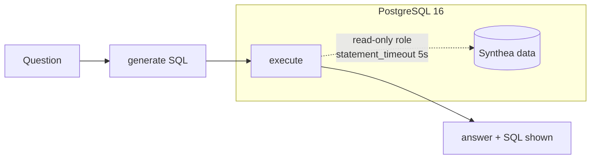
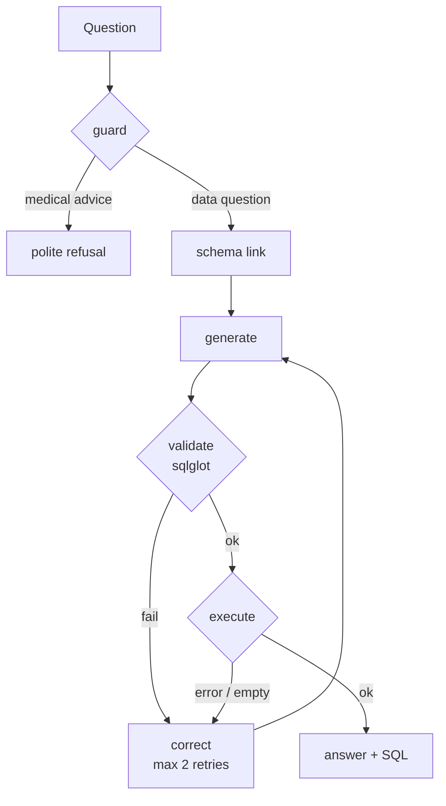

# 🩺 Clinical Text-to-SQL Agent

A text-to-SQL agent that turns clinician questions into **read-only PostgreSQL queries** over synthetic
patient records, then explains the result in plain language, always showing the SQL it ran.

Built with **LangGraph · PostgreSQL 16 · FastAPI · Streamlit · Docker**, on any OpenAI-compatible LLM
endpoint (Groq, Ollama, vLLM).

> **Status: v0.2 (benchmark + baseline).** The end-to-end pipeline, database, API, UI and a 90-question
> benchmark work. Schema linking, SQL validation, self-correction and the refusal guard are next;
> only **measured** numbers are published here.

---

## How it works



Planned graph for v1.0 (each addition is a node, so ablations are just removing one):



### Safety by design
- **Database-level:** the agent connects as a `readonly` role (no write privileges,
  `default_transaction_read_only = on`, `statement_timeout = 5s`). Verified: `DROP`/`UPDATE` are rejected
  and long queries are cancelled, even without any application-side checks.
- **Planned application-level:** `sqlglot` validation (single `SELECT`, no DDL/DML, known tables and
  columns, injected `LIMIT 100`) and a guard that refuses diagnosis/treatment requests.

## Quickstart

Requirements: Python 3.11+, [uv](https://docs.astral.sh/uv/), Docker, Java 17+ (for Synthea),
and an API key for an OpenAI-compatible LLM provider (e.g. [Groq](https://console.groq.com), free tier).

```bash
git clone https://github.com/<you>/clinical-sql-agent && cd clinical-sql-agent

# 1. Configure (never commit .env)
cp .env.example .env          # then edit: set passwords and LLM_API_KEY

# 2. Database
docker compose up -d postgres

# 3. Data: generate synthetic patients (seed 42) and load them
uv sync
POPULATION=2000 bash scripts/generate_synthea.sh
uv run python scripts/load_postgres.py

# 4. Ask a question
uv run python -m csql "How many female patients are older than 60?"
```

### Run the UI

```bash
# terminal 1 — API
uv run uvicorn csql.api:app --port 8000
# terminal 2 — UI
uv run streamlit run app/streamlit_app.py      # http://localhost:8501
```

`POST /ask` returns `{sql, columns, rows, answer, trace, refused, error}`.

### Choosing a model

Any OpenAI-compatible server works; only three variables change:

```env
LLM_BASE_URL=https://api.groq.com/openai/v1   # or http://localhost:11434/v1 for Ollama
LLM_API_KEY=your-key
LLM_MODEL=openai/gpt-oss-120b
```

You can also override per call: `python -m csql "..." --model openai/gpt-oss-20b`.

## Data

Synthetic patients from [Synthea](https://github.com/synthetichealth/synthea) — no real patient data, no
privacy concerns. Pinned for reproducibility: seed `42`, snapshot date `2026-01-01` (simulation end + age reference; the agent is told
"today" is that date). Current load: 2,000 requested patients (2,248 patient rows incl. replacements for deceased),
~1.5M observations, ~344k procedures; encounters end on 2025-12-31.

Tables: `patients`, `encounters`, `conditions`, `medications`, `observations`, `procedures`,
`allergies`, `immunizations`, with primary/foreign keys and indexes.

## Benchmark

`bench/questions.jsonl` — 90 questions with gold SQL: 30 easy (single table), 30 medium (joins),
30 hard (aggregation, CTEs, date logic). 60 are the **dev** split used while building; 30 are a
**held-out test** split that is only run at the end. Gold SQL was written before looking at any model
output and `bench/check_gold.py` verifies every gold query runs, is non-empty/non-trivial, returns ≤100
rows and finishes inside the 5s DB timeout. Metric: **execution accuracy** (result sets compared as
multisets; row/column order ignored, floats rounded to 2 decimals).

```bash
uv run python bench/check_gold.py
uv run python bench/run_eval.py --model openai/gpt-oss-120b --config baseline --split dev
uv run python bench/compare.py          # -> bench/results/summary.md
```

### Baseline results (dev split, 60 questions, 1 run, temperature 0)

| Model | Easy | Medium | Hard | Overall |
|---|---|---|---|---|
| openai/gpt-oss-120b | 95.0% | 95.0% | 85.0% | **91.7%** |
| openai/gpt-oss-20b | 90.0% | 100.0% | 80.0% | **90.0%** |
| qwen/qwen3.8-27b | 95.0% | 90.0% | 80.0% | **88.3%** |

Baseline = generate → execute, no linking/validation/retry. With 20 questions per level, one question is
5 points: differences of a few points between models are within noise. Full table:
[`bench/results/summary.md`](bench/results/summary.md).

Observed baseline failure types: hallucinated columns, `integer` vs `interval` date arithmetic, wrong
literal values (e.g. `'Systolic blood pressure'` vs `'Systolic Blood Pressure'`, unit `mmHg` vs `mm[Hg]`)
returning empty results, and wrong averages (join fan-out, truncated durations).

## Repository layout

```
src/csql/        config, llm client, schema introspection, db access, LangGraph, FastAPI
  nodes/         generate, execute, answer  (validate, link, correct, guard coming)
app/             Streamlit UI
scripts/         generate_synthea.sh, load_postgres.py
docker/initdb/   creates the read-only Postgres role
bench/           questions.jsonl, check_gold.py, run_eval.py, compare.py, results/
tests/           unit tests
```

## Roadmap

- [x] **v0.1** Synthea data, Postgres + read-only role, baseline agent, FastAPI, Streamlit
- [x] **v0.2** 90-question benchmark (30 easy / 30 medium / 30 hard) with gold SQL; execution-accuracy
      runner; baseline numbers for 3 models (dev split)
- [ ] Validation (`sqlglot`), schema linking, self-correction, refusal guard
- [ ] Ablation grid: 3 models × {baseline, +linking, +correction, +both}; variance over 3 runs
- [ ] **v1.0** Dockerized API + UI, GitHub Actions (ruff + unit tests), failure analysis, screenshots

### Evaluation protocol
Gold SQL is written before looking at model output. 60 questions are used during development and
30 are held out and run only at the end; both are reported. Model tags and the data seed are pinned.

## Limitations

- The baseline has no validation or retry: a share of generated queries fail (e.g. type errors).
- "Executed without error" ≠ "correct" — correctness is measured by comparing result sets with gold SQL.
- Synthetic data does not reflect real clinical distributions; this is a research/portfolio project,
  **not** a clinical decision tool.

## Development

```bash
uv run ruff check . && uv run ruff format .
uv run pytest
```

## Credits & licence

Data generated with [Synthea™](https://github.com/synthetichealth/synthea) (Apache-2.0).
Code released under the [MIT licence](LICENSE).
