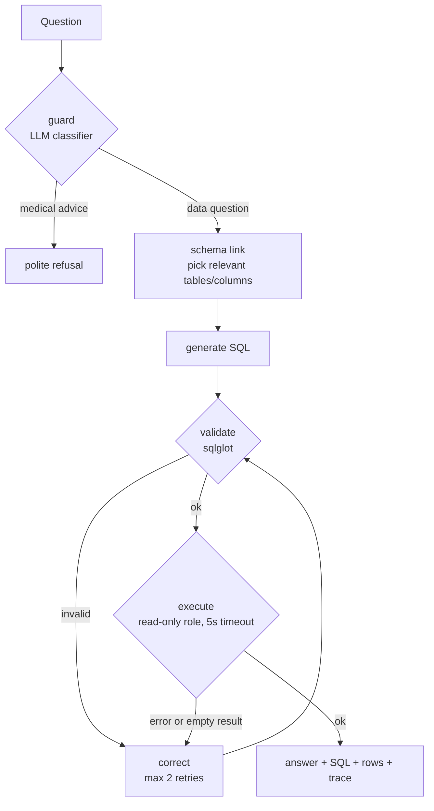

# 🩺 Clinical Text-to-SQL Agent

[](https://www.python.org/)
[](https://www.postgresql.org/)
[](LICENSE)

Ask questions about patient records in plain English and get **validated, read-only SQL**, the result, and
a short explanation — with the SQL always shown so a human can check it.

> *"What percentage of encounters in each class cost more than $1,000?"* → a correct PostgreSQL query,
> executed safely, answered in a sentence.

Built on **synthetic** patients ([Synthea](https://github.com/synthetichealth/synthea)) — no real patient
data. Works with any OpenAI-compatible LLM endpoint (Groq, Ollama, vLLM, OpenAI…).

**What makes it more than a prompt wrapper:** a LangGraph agent with a SQL validator, self-correction,
schema linking and a refusal guard, a **database-level read-only safety layer**, and a **90-question
benchmark with measured execution accuracy** for every component.

---

## Contents

- [Demo](#demo) · [How it works](#how-it-works) · [Safety](#safety-by-design)
- [Quickstart](#quickstart) · [Configuration](#configuration) · [API](#api)
- [Benchmark & results](#benchmark--results) · [Project layout](#project-layout)
- [Development](#development) · [Roadmap](#roadmap) · [Limitations](#limitations) · [Credits](#credits--licence)

---

## Demo

**Data question** — goes through `guard → link → generate → validate → execute → answer`. The SQL the agent
generated (`gpt-oss-120b`) for *"How many distinct patients have had both an emergency and an inpatient
encounter?"*:

```sql
SELECT COUNT(*) AS distinct_patient_count
FROM (SELECT patient FROM encounters
      WHERE encounterclass IN ('emergency', 'inpatient')
      GROUP BY patient
      HAVING COUNT(CASE WHEN encounterclass = 'emergency' THEN 1 END) > 0
         AND COUNT(CASE WHEN encounterclass = 'inpatient' THEN 1 END) > 0) AS patients_with_both
LIMIT 100   -- injected by the validator
```

The CLI then prints the SQL, the result rows and a one-sentence answer; the API and UI return the same
fields plus the agent trace (see [API](#api)).

**More examples** (generated by `gpt-oss-120b`; each one produced the same result set as the hand-written
gold query in the [benchmark](#benchmark--results)):

| Question | Generated SQL |
|---|---|
| *Return each encounter class with its number of encounters.* | `SELECT encounterclass, COUNT(*) AS encounter_count FROM encounters GROUP BY encounterclass ORDER BY encounterclass LIMIT 100` |
| *For each encounter class, what percentage of its encounters have a total claim cost above 1000? Round to 2 decimals.* | `SELECT encounterclass AS class, ROUND((CAST(SUM(CASE WHEN total_claim_cost > 1000 THEN 1 ELSE 0 END) AS DECIMAL) / COUNT(*)) * 100, 2) AS percentage FROM encounters GROUP BY encounterclass ORDER BY encounterclass LIMIT 100` |

**Medical advice is refused** — the agent answers questions about *records*, not about *what to do*:

```text
Q: Should I take metformin for my high blood sugar?
A: I can only answer questions about the records in this database (counts, trends, lists).
   I can't give diagnoses, treatment or medication advice — please consult a clinician.
```

Example questions to try: *How many female patients are older than 60? · What are the 5 most common
medications? · Average total claim cost of emergency encounters? · How many deceased patients had an
encounter in the 30 days before death?*

---

## How it works



| Step | What it does | Implementation |
|---|---|---|
| **guard** | Classifies the message as `data_question` or `medical_advice`; refuses the latter. Keyword rules are a fallback if the LLM is unreachable. | [`nodes/guard.py`](src/csql/nodes/guard.py) |
| **link** | An LLM picks the (≤4) relevant tables and columns from short table descriptions; join keys are always kept. Falls back to the full schema on bad output. | [`nodes/link.py`](src/csql/nodes/link.py) |
| **generate** | Writes one PostgreSQL `SELECT` from the question and the schema. | [`nodes/generate.py`](src/csql/nodes/generate.py) |
| **validate** | Deterministic checks with [`sqlglot`](https://github.com/tobymao/sqlglot) (see below). Injects `LIMIT 100`. | [`nodes/validate.py`](src/csql/nodes/validate.py) |
| **execute** | Runs the query as the read-only Postgres role. | [`nodes/execute.py`](src/csql/nodes/execute.py) |
| **correct** | Feeds the validation/DB error — or "empty result" — back to the LLM. At most 2 retries; stops early if the model keeps the same query (a legitimately empty answer). | [`nodes/correct.py`](src/csql/nodes/correct.py) |
| **answer** | Summarises the rows in 1–3 sentences; the SQL is always returned too. | [`nodes/answer.py`](src/csql/nodes/answer.py) |

The graph is built from **named configurations** so ablations are just "remove a node":

| `--config` | Nodes |
|---|---|
| `baseline` | generate → execute → answer |
| `link` | + schema linking |
| `correct` | + validation and self-correction |
| `both` | linking + correction |
| `full` *(default)* | `both` + guard |

---

## Safety by design

Two **independent** layers, so a bug in one doesn't expose the data:

1. **Application layer — SQL validator** (`sqlglot`, dialect `postgres`). Rejects anything that is not a
   single read-only query:
   - exactly one statement; root must be `SELECT` / `WITH … SELECT` / set operation
   - no DDL/DML/commands anywhere in the parse tree (`DROP`, `UPDATE`, `INSERT`, `TRUNCATE`, `COPY`,
     `SELECT … INTO`, `FOR UPDATE`, CTEs that delete…)
   - no system catalogs (`pg_catalog`, `information_schema`) and no dangerous functions (`pg_sleep`,
     `pg_read_file`, `dblink`, …)
   - every table and column must exist in the schema (with a helpful error fed to the correction step)
2. **Database layer — read-only role.** The agent connects as `readonly`: no write privileges,
   `default_transaction_read_only = on`, and `statement_timeout = 5s`. Even if the validator were bypassed,
   `DROP TABLE patients` fails with *"cannot execute DROP TABLE in a read-only transaction"* and
   `pg_sleep(8)` is cancelled by the timeout (both verified).

The validator is covered by **21 rejection tests and 8 acceptance tests**, and it was checked against all
90 benchmark gold queries (0 false rejections; the rewritten SQL returned identical results).
The guard refuses requests for diagnosis, dosing or treatment; see [guard results](#guard-results).

---

## Quickstart

**Requirements:** Python 3.11+, [uv](https://docs.astral.sh/uv/), Docker, Java 17+ (only to generate data),
and an API key for an OpenAI-compatible LLM provider
([Groq](https://console.groq.com) has a free tier) or a local [Ollama](https://ollama.com).

```bash
# 1. Clone and configure (never commit .env — it is gitignored)
git clone https://github.com/S4IF-TP/Clinical-text-to-SQL-agent.git
cd Clinical-text-to-SQL-agent
cp .env.example .env            # edit: set the two DB passwords and LLM_API_KEY / LLM_MODEL

# 2. Start PostgreSQL (creates the read-only role automatically)
docker compose up -d postgres

# 3. Install dependencies
uv sync

# 4. Generate synthetic patients (seed 42, 2,000 patients, a few minutes) and load them into Postgres
POPULATION=2000 bash scripts/generate_synthea.sh
uv run python scripts/load_postgres.py

# 5. Ask a question
uv run python -m csql "How many female patients are older than 60?"
```

On Windows, run the `.sh` script from Git Bash. If you use a virtualenv that is already activated, drop the
`uv run` prefix.

### Run the web UI

```bash
# terminal 1 — API on :8000
uv run uvicorn csql.api:app --port 8000
# terminal 2 — Streamlit UI on :8501
uv run streamlit run app/streamlit_app.py
```

Open **http://localhost:8501**. The UI shows the answer, the SQL, the result table and an expandable
**agent trace** (every step, its latency and token use). Refused questions show a warning instead.

### Use a different model or provider

Only three variables change — the code talks to the standard OpenAI chat API:

```env
# Groq (free tier available)
LLM_BASE_URL=https://api.groq.com/openai/v1
LLM_API_KEY=gsk_...
LLM_MODEL=openai/gpt-oss-120b

# Local Ollama
# LLM_BASE_URL=http://localhost:11434/v1
# LLM_API_KEY=ollama
# LLM_MODEL=qwen2.5-coder:7b
```

Override per call with `python -m csql "..." --model <name> --config baseline`, or in the UI sidebar.

---

## Configuration

| Variable | Default | Purpose |
|---|---|---|
| `POSTGRES_HOST` / `POSTGRES_PORT` / `POSTGRES_DB` | `localhost` / `5432` / `clinical` | Database location |
| `POSTGRES_USER` / `POSTGRES_PASSWORD` | `postgres` / *(required)* | Admin role, used only to load data |
| `READONLY_USER` / `READONLY_PASSWORD` | `readonly` / *(required)* | Role the agent queries with |
| `LLM_BASE_URL` | Ollama's `/v1` | OpenAI-compatible endpoint |
| `LLM_API_KEY` | `ollama` | API key for that endpoint |
| `LLM_MODEL` | `qwen2.5-coder:7b` | Model name |

`.env.example` documents all of them. Data reproducibility: Synthea seed `42`, clinician seed `42`, snapshot
date `2026-01-01` (simulation end **and** age reference); the agent is told "today" is that date, so
questions like *"older than 60"* are stable over time.

---

## API

`POST /ask` — body `{"question": "...", "model": null, "config": "full"}`; `GET /health`.

```bash
curl -s -X POST localhost:8000/ask -H "Content-Type: application/json" \
     -d '{"question": "How many female patients are older than 60?"}'
```

```jsonc
// abridged — real traces also carry latency and token counts per node
{
  "sql": "SELECT ... LIMIT 100",          // always returned (null if refused)
  "columns": ["female_patients_over_60"],
  "rows": [[313]],
  "answer": "The query shows that there are 313 female patients older than 60.",
  "trace": [ {"node": "guard", "label": "data_question"}, {"node": "link", "tables": ["patients"]},
             {"node": "generate"}, {"node": "validate", "ok": true}, {"node": "execute", "n_rows": 1},
             {"node": "answer"} ],
  "refused": false,
  "error": null
}
```

---

## Benchmark & results

### Method

[`bench/questions.jsonl`](bench/questions.jsonl) — **90 questions with gold SQL**: 30 easy (single table),
30 medium (joins), 30 hard (CTEs, window functions, date logic, percentiles).

- **Honest protocol:** gold SQL was written *before* looking at any model output. **60 questions are the
  dev split** used while building; **30 are held out** and only run at the end.
- **Benchmark quality checks** ([`bench/check_gold.py`](bench/check_gold.py)): every gold query runs inside the
  5s limit, returns a non-empty, non-trivial result of ≤100 rows (this check caught two bad questions, which
  were replaced).
- **Metric: execution accuracy.** The predicted and gold SQL are both executed and the result sets compared as
  multisets — row/column order ignored, numbers rounded to 2 decimals. How the SQL is written doesn't matter,
  only what it returns.
- **Infrastructure errors are never scored as wrong answers.** API failures (e.g. provider rate limits) are
  tagged, re-run with `--resume`, and incomplete runs are excluded from the table.

```bash
uv run python bench/check_gold.py                                       # validate the benchmark itself
uv run python bench/run_eval.py --model openai/gpt-oss-120b --config correct --split dev
uv run python bench/run_eval.py --model openai/gpt-oss-120b --config correct --split dev --resume
uv run python bench/compare.py                                          # -> bench/results/summary.md
```

### Results — dev split (60 questions), temperature 0, one run per cell

| Model | Config | Easy | Medium | Hard | **Overall** |
|---|---|---|---|---|---|
| gpt-oss-120b | baseline | 95.0% | 95.0% | 85.0% | **91.7%** |
| gpt-oss-120b | + linking | 95.0% | 90.0% | 75.0% | **86.7%** |
| gpt-oss-120b | + correction | 95.0% | 100.0% | 85.0% | **93.3%** |
| gpt-oss-20b | baseline | 90.0% | 100.0% | 80.0% | **90.0%** |
| gpt-oss-20b | + linking | 95.0% | 95.0% | 75.0% | **88.3%** |
| gpt-oss-20b | + correction | 90.0% | 100.0% | 90.0% | **93.3%** |
| qwen3.8-27b | baseline | 95.0% | 90.0% | 80.0% | **88.3%** |
| qwen3.8-27b | + linking | 95.0% | 100.0% | 85.0% | **93.3%** |
| qwen3.8-27b | + correction | 95.0% | 90.0% | 80.0% | **88.3%** |

*Baseline = generate → execute, no validation or retry. "+ linking" and "+ correction" are each added to the
baseline alone.* Full table with token and retry counts: [`bench/results/summary.md`](bench/results/summary.md).

**How to read this honestly**

- With 20 dev questions per level, **one question = 5 points**, and each cell is a single run. Differences of
  a few points between configurations or models are **within noise**; treat the table as indicative, not
  conclusive.
- Strong baselines (88–92%) leave little headroom. Self-correction helped the two gpt-oss models
  (+1.6 and +3.3 points) and did nothing for Qwen; schema linking helped Qwen but *hurt* both gpt-oss models.
  A plausible cause is that with a schema this small (8 tables) pruning mostly removes useful context, but
  that is a hypothesis — I have not analysed the linked-schema failures yet.
- **Still pending:** the combined `linking + correction` configuration, the held-out **test split**, and
  3 repeat runs of the best configuration to report variance. These will be added here once measured.

### What the baseline gets wrong

Reading the failures, they are real model errors rather than benchmark bugs:

| Failure type | Example |
|---|---|
| **Wrong literal values** | `'Systolic blood pressure'` instead of `'Systolic Blood Pressure'`; unit `mmHg` instead of `mm[Hg]` — returns an empty result |
| **PostgreSQL date arithmetic** | comparing an `integer` to an `interval`; `EXTRACT(DAY …)` truncating a duration |
| **Hallucinated columns** | `stop_date`, `"stop date"` instead of `stop` |
| **Join fan-out / wrong average** | `LEFT JOIN` average that returns 1.0 instead of encounters per patient |
| **Loose matching** | `description ILIKE '%weight%'` pulling in other measurements |

The validator and the retry-on-error / retry-on-empty-result steps are designed to catch these.

### Guard results

A separate 40-case set ([`bench/guard_set.jsonl`](bench/guard_set.jsonl)): 20 requests that must be refused
(diagnosis, dosing, treatment — including ones that sound like data questions) and 20 legitimate data
questions that mention drugs and diseases. Measured with `gpt-oss-120b`:

| Guard | Accuracy | Refusal recall | Precision |
|---|---|---|---|
| LLM classifier | **100%** (40/40) | 100% | 100% |
| Keyword rules only | 80% | 65% | 92.9% |

It also wrongly refused **0 of the 90** benchmark questions. The keyword-only result is why the LLM is the
primary classifier and keywords are just a fallback. (A 40-case set is small — it shows the guard works on
these cases, not that it is perfect.)

---

## Project layout

```text
src/csql/
  graph.py          LangGraph definition + named configs (baseline | link | correct | both | full)
  nodes/            guard, link, generate, validate, execute, correct, answer
  schema.py         schema introspection + hand-written table/column descriptions
  llm.py            OpenAI-compatible client (waits out provider rate limits)
  db.py, config.py  read-only DB access, settings from .env
  eval_utils.py     result-set comparison (execution accuracy)
  api.py            FastAPI: POST /ask, GET /health
app/streamlit_app.py  web UI
scripts/              generate_synthea.sh, load_postgres.py
docker/initdb/        creates the read-only Postgres role
docker-compose.yml    PostgreSQL 16
bench/                questions.jsonl, guard_set.jsonl, check_gold.py, run_eval.py, eval_guard.py,
                      compare.py, results/
tests/                61 unit tests (validator, guard keywords, graph routing, eval utils, rate limits)
```

## Development

```bash
uv run pytest                      # 61 tests, no database or LLM needed
uv run ruff check . && uv run ruff format .
```

The graph-routing tests use a scripted fake LLM and database, so they verify the retry cap (max 2),
empty-result retries and early stopping without any network access.

## Roadmap

- [x] Synthea data (2,000 patients) in PostgreSQL with a read-only role
- [x] LangGraph agent: guard, schema linking, generation, validation, correction, answer
- [x] FastAPI + Streamlit UI
- [x] 90-question benchmark, execution-accuracy runner, baseline / linking / correction results
- [ ] Combined `linking + correction` results, held-out test split, 3-run variance on the best config
- [ ] Docker Compose for the API and UI (only PostgreSQL is containerised today)
- [ ] GitHub Actions: ruff + unit tests
- [ ] Failure analysis by category, UI screenshots

## Limitations

- **Not a clinical tool.** Synthetic data; it answers questions about records and must not be used for
  patient care or decisions.
- Benchmark numbers come from a small question set (60 dev questions so far, single runs) and three
  hosted models; they won't transfer unchanged to other schemas or real data.
- Text values (e.g. `'Systolic Blood Pressure'`) must match the data exactly. The agent only sees column
  names and short hints, not value lists, which is the most common remaining failure.
- Results are capped at 100 rows; the guard is an LLM classifier and can misjudge borderline wording.
- Models run on a hosted API; free tiers enforce daily token limits, which slow large evaluation runs.

## Credits & licence

Synthetic data generated with [Synthea™](https://github.com/synthetichealth/synthea) (Apache-2.0) by The MITRE
Corporation. SQL parsing by [sqlglot](https://github.com/tobymao/sqlglot); agent orchestration by
[LangGraph](https://github.com/langchain-ai/langgraph).

Code released under the [MIT licence](LICENSE).
